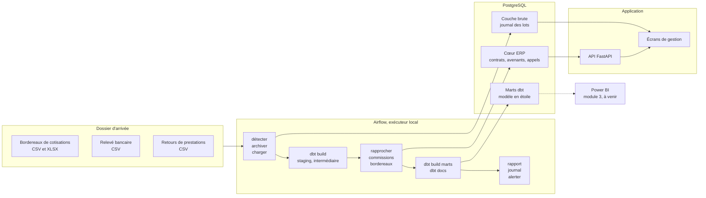

# courtage-erp

Un courtier grossiste délégataire reçoit chaque mois le bordereau de cotisations de ses compagnies, le
relevé de sa banque et le retour de prestations de son concentrateur de tiers payant. Il doit en tirer
trois choses avant de facturer quoi que ce soit : quelles cotisations appelées ont été encaissées,
combien les compagnies lui doivent de commission, et combien il reverse à chacun de ses apporteurs. Ce
dépôt est un mini-ERP qui fait ce travail, contrôles compris, sur un portefeuille simulé de 5 737
contrats et trois ans d'historique.

Données entièrement synthétiques, produites par le dépôt lui-même à graine fixe. Aucune donnée réelle,
aucun barème légal reproduit : chaque valeur métier est une hypothèse de simulation, listée dans
`docs/HYPOTHESES.md`.

## Architecture



Un lot rejeté par les contrôles ne laisse aucune ligne en base, et la tâche terminale `alerter` fait
échouer le graphe pour que le rejet se voie dans Airflow.

## Démarrage

```bash
docker compose up -d --build
```

La pile monte PostgreSQL, applique les migrations, génère le jeu de démonstration, dépose le courrier
simulé du mois, puis démarre l'application et Airflow. Deux adresses, sur la boucle locale seulement :

- l'ERP sur http://127.0.0.1:8000, avec sa documentation d'API sur `/api/doc` ;
- Airflow sur http://127.0.0.1:8080, compte `admin`, mot de passe `courtage`, à changer pour tout
  usage autre qu'une démonstration.

Pour dérouler la chaîne, activer le graphe `courtage_flux_financiers` dans Airflow et le déclencher.

Le même code tourne sans Docker, sur SQLite, ce qui est le chemin de développement rapide et celui d'un
relecteur qui n'a pas Docker :

```bash
make installer && make migrer && make generer && make servir
```

`make aide` liste les commandes. `make preuves` rejoue toutes les preuves du dépôt.

## Ce qui est livré

### Module 1, cœur ERP

Le problème : un contrat d'assurance change pendant sa vie, de formule, de tarif, d'apporteur, et un
gestionnaire doit pouvoir dire dans quel état il était à une date donnée, trois ans plus tard, parce que
c'est sur cet état que se calcule une commission ou se règle une prestation. La réponse retenue est
l'historisation par avenants : chaque événement crée une version, et l'état à une date se reconstitue en
relisant les avenants jusqu'à cette date. Le cache porté par la table `contrat` est comparé à cette
reconstitution par un contrôle de cohérence, de sorte que les deux ne peuvent pas diverger en silence.
Vingt-trois tables pour ce module, trente et une avec celles du module 2, cinq révisions de migration
qui montent et redescendent sans résidu, et des contraintes de vérification en base plutôt que dans le
seul code applicatif, parce qu'un ERP reçoit aussi des écritures par imports et par scripts de reprise. Le détail et la justification de chaque choix
sont dans `docs/modele-donnees.md`.

La délégation de gestion traverse tout le module, et c'est ce qui distingue un courtier délégataire d'un
courtier simple : le cabinet accomplit au nom de la compagnie des actes qui appartiennent normalement à
l'assureur, dans le périmètre d'une convention datée. Le jeu de démonstration contient une convention
arrivée à échéance et non renouvelée, pour que le refus soit constatable et pas seulement codé.

### Module 2, flux financiers

Le problème : le rapprochement entre ce qui a été appelé et ce qui a été encaissé se fait encore à la
main dans beaucoup de cabinets, il prend plusieurs jours par mois et il se trompe sur les lignes que
personne ne vérifie. La chaîne est orchestrée par Airflow en quatorze tâches, chacune appelant une
commande et lisant un code de retour, ce qui permet de la rejouer entièrement à la main sur un poste
sans Airflow.

Huit contrôles bloquants s'appliquent avant toute écriture : schéma et types, fichier déjà chargé par
son empreinte, doublon de clé métier, contrat ou adhérent inconnu, somme des lignes différente du total
déclaré, période incohérente avec la garantie, et acte non délégué. Un seul échec rejette le lot entier,
sans écriture partielle, et le fichier part dans le dossier des rejets avec son rapport d'anomalies, qui
est la pièce renvoyée à l'émetteur. Le rapprochement se fait d'abord par référence, puis par montant et
date dans une fenêtre paramétrable, et il conserve la méthode employée : une correspondance par montant
est une présomption, pas une certitude, et le gestionnaire qui instruit un litige doit savoir laquelle
il relit.

Les transformations dbt sont en couches, des sources aux marts, avec leurs tests et leur lineage. Les
commissions sont calculées au taux en vigueur à la date d'échéance de l'appel, pas au taux du jour,
faute de quoi une revalorisation du barème réécrirait des bordereaux déjà réglés.

### Preuves

Chaque chiffre publié dans la documentation vient d'un fichier de `results/`, produit par une exécution
réelle. L'intégration continue rejoue l'ensemble sur SQLite et sur PostgreSQL, et monte la pile Docker.

| Preuve | Résultat | Fichier |
| --- | --- | --- |
| Migrations qui montent et redescendent | 6 révisions, 31 tables, aucun résidu | `results/migrations_sqlite.json` |
| Génération reproductible | même graine, même empreinte, sur les deux moteurs | `results/reproductibilite_sqlite.json` |
| Cohérence métier des données | 18 contrôles, tous conformes | `results/coherence_metier.json` |
| La base refuse les écritures interdites | 5 insertions SQL directes sur 5 refusées | `results/contraintes_sqlite.json` |
| Les tests détectent les défauts qu'ils couvrent | 9 défauts réintroduits, 9 détectés | `results/mutation.json` |
| Suite de tests | 231 passés, 10 sautés | `results/pytest.txt` |
| Détection des anomalies contre la vérité terrain | rappel et précision par contrôle | `results/flux_rapport_detection.json` |
| Journal d'exécution par lot | 27 lots, 9 rejetés | `results/flux_journal_lots.json` |
| Alerte sur lot rejeté | code de retour 1 sur les 9 rejets du jeu | `results/flux_alerte_rejets.json` |

## Limites assumées

- **Le portefeuille est simulé.** Les signaux qu'il contient, saisonnalité des soins, hausses tarifaires
  au 1er janvier, résiliations liées à l'ancienneté et au tarif, sont ceux qu'un générateur y a mis. Ce
  qui se démontre ici est la mécanique, pas la réalité d'un marché.
- **Le bordereau de commissions reçu de la compagnie n'est pas ingéré.** Quand la compagnie encaisse
  elle-même, le cabinet est commissionné sur la base du bordereau qu'elle lui adresse ; faute de ce
  quatrième flux, le calcul retient la cotisation appelée hors taxe, qui est la meilleure assiette
  observable. Ces lignes sont comptées à part pour rester rapprochables. Voir `docs/DECISIONS.md`, D24
  et D25.
- **Le bordereau de prestations émis vers la compagnie n'est pas modélisé.** Le module traite les flux
  entrants, là où se posent le contrôle et le rejet. Voir D22 et D23.
- **Une police collective n'a pas d'avenants.** L'apporteur d'une police est celui enregistré sur elle,
  sans historisation, à la différence d'un contrat individuel.
- **Le domaine des énumérations n'est pas tenu par la base.** Il l'est par la validation applicative,
  pour une raison de portabilité expliquée dans `docs/modele-donnees.md`.
- **Les modules 3 à 6 restent à faire** : pilotage Power BI, agent de pré-remplissage, prédiction de
  résiliation, page de présentation. L'état exact est dans `docs/PROGRESS.md`.

## Où regarder

| Fichier | Contenu |
| --- | --- |
| `docs/PROGRESS.md` | état réel, preuve par preuve, et comment reprendre |
| `docs/flux-financiers.md` | la chaîne du module 2, étape par étape |
| `docs/modele-donnees.md` | diagramme entité-association et justification de chaque choix |
| `docs/DECISIONS.md` | une ligne par choix technique, avec l'alternative écartée |
| `docs/HYPOTHESES.md` | toute valeur métier simulée, marquée comme hypothèse |
| `docs/lessons/` | ce que le projet a appris en se trompant |
| `results/` | sorties des exécutions réelles, source de tout chiffre publié |

## Licence

MIT, voir `LICENSE`.
