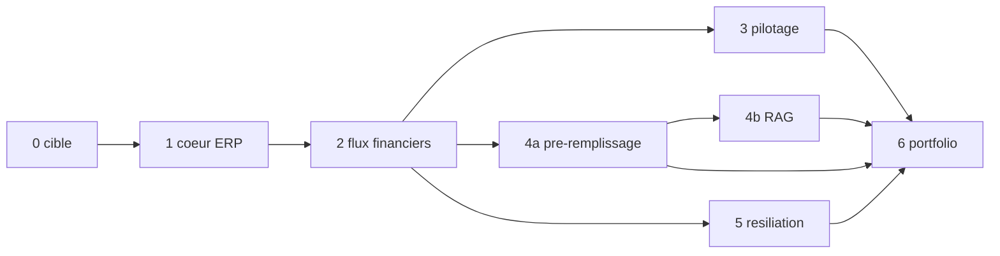

Plan d'exécution du projet courtage-erp, découpé en étapes qu'une session fraîche peut reprendre seule. Point de reprise.

# Plan du projet courtage-erp

Écrit le 19/10/2026. La spécification de référence est `le cahier des charges du projet, conserve hors du depot` et elle fait foi. Ce plan ne la
rediscute pas : il la découpe.

## Ce que le projet doit prouver

Un mini-ERP de courtage grossiste en santé et prévoyance, assez juste métier pour qu'un gestionnaire le
relise sans tiquer, et assez solide techniquement pour qu'un éditeur de logiciel de courtage y reconnaisse
du travail de production. Six modules, dont le cœur ERP est le premier et porte tout le reste.

## Socle technique retenu

Arrêté une fois pour toutes, consigné dans `docs/DECISIONS.md`, appliqué sans y revenir.

| Brique | Retenu |
| --- | --- |
| Langage | Python 3.12 |
| Base de production | PostgreSQL 16, en conteneur |
| Base de développement | SQLite, même code, même schéma |
| Accès aux données | SQLAlchemy 2.0 |
| Migrations | Alembic |
| API | FastAPI et Pydantic v2, documentation OpenAPI produite par le code |
| Interface | Jinja2 et HTMX, servis par la même application, sans chaîne Node |
| Montants | entiers de centimes en base |
| Orchestration | Apache Airflow, `LocalExecutor` (imposé) |
| Transformations | dbt (imposé) |
| Pilotage | Power BI, projet PBIP et modèle TMDL (imposé) |
| Tests et style | pytest, ruff |
| Environnement | uv, `pyproject.toml` et `uv.lock` |

## Contraintes de la machine, état au 19/10/2026

1. **Docker fonctionne.** Vérifié dans la session du 19/10 : `docker info` répond 29.8.2, conteneurs
   Linux, 8 processeurs, 4 031 537 152 octets, soit environ 3,75 Go pour la machine virtuelle ;
   `docker compose version` répond v5.6.0. Le défaut du matin (socket de télémétrie périmé) a été réparé
   par Yasmina. `docker compose up` est donc la démonstration locale réelle. L'intégration continue reste
   la preuve reproductible pour un lecteur extérieur, elle n'est plus le seul chemin.
2. **La mémoire reste la vraie limite.** 8 Go au total, 807 544 Ko libres au moment de la mesure, et
   3,75 Go alloués à la machine virtuelle Docker. Donc : `LocalExecutor` et non Celery, pas de Redis, un
   seul service PostgreSQL pour les métadonnées d'Airflow et pour l'ERP, limites mémoire déclarées service
   par service, empreinte réelle mesurée avec `docker stats` et consignée.
3. **Tout ce qui peut tourner nativement tourne aussi sans Docker.** Migrations, génération, tests, API et
   interface s'exécutent sur SQLite avec `python -m uv run`, sans conteneur. C'est le chemin rapide du
   développement et celui d'un relecteur qui n'a pas Docker.
4. **Aucune clé d'API de modèle de langage.** Ollama est installé, service à démarrer, modèles
   `qwen2.5:1.5b-instruct-q4_K_M` et `qwen2.5:0.5b-instruct-q4_K_M`. Le module 4 est donc écrit derrière
   une interface de modèle à trois implémentations : Ollama local, fournisseur distant, et rejeu de
   réponses enregistrées. Le rejeu est le mode par défaut des tests, pour qu'ils passent sans clé.
5. **Power BI Desktop 2.157.1354.0 est installé.** L'ouverture du projet et les captures du tableau de
   bord demandent Yasmina : ce n'est pas automatisable.

## Structure du dépôt

```
courtage-erp/
├── README.md                     accroche métier, architecture, démarrage, limites (module 6)
├── LICENSE                       MIT
├── Makefile                      opérations courantes, `make aide` les liste
├── docker-compose.yml            pile complète, démarrage en une commande
├── pyproject.toml / uv.lock      environnement Python verrouillé
├── alembic.ini                   configuration des migrations
├── .env.example                  variables attendues, sans secret
├── .github/workflows/ci.yml      style, tests, migrations, pile Docker prouvée
├── docker/
│   ├── Dockerfile.erp            application ERP (API et interface)
│   └── Dockerfile.airflow        image Airflow (module 2)
├── migrations/versions/          révisions Alembic, une par changement de schéma
├── src/courtage/
│   ├── config.py                 paramètres, lecture d'environnement
│   ├── db.py                     moteur, session, portabilité des deux moteurs
│   ├── modeles/                  entités SQLAlchemy
│   │   ├── base.py               base déclarative, types partagés
│   │   ├── enums.py              énumérations métier (branche, statut, motif, type d'avenant)
│   │   ├── referentiel.py        compagnie, produit, garantie, formule, apporteur, taux
│   │   ├── portefeuille.py       entreprise souscriptrice, adhérent, contrat, avenant
│   │   └── financier.py          appel de cotisation, encaissement, prestation, commission,
│   │                             rétrocession, bordereau
│   ├── domaine/                  règles métier, sans dépendance au transport
│   │   ├── cycle_vie.py          transitions de statut du contrat, motif obligatoire
│   │   ├── avenants.py           historisation, reconstitution de l'état à une date
│   │   └── montants.py           centimes, taxes, arrondis, taux datés
│   ├── services/                 cas d'usage transactionnels
│   ├── api/                      application FastAPI, schémas Pydantic, routes
│   ├── interface/                vues, gabarits Jinja2, feuille de style
│   ├── generateur/               génération déterministe du jeu de démonstration
│   └── cli.py                    commandes : migrer, generer, empreinte, servir
├── dags/                         graphes Airflow (module 2)
├── dbt/                          projet dbt (module 2)
├── ia/                           pré-remplissage et RAG (module 4)
├── ml/                           prédiction de résiliation (module 5)
├── powerbi/                      projet PBIP, modèle TMDL, mesures DAX (module 3)
├── scripts/                      preuves et exports reproductibles
├── results/                      sorties d'exécution réelles, source de tout chiffre publié
├── tests/                        pytest, exécutés sur SQLite et sur PostgreSQL
└── docs/
    ├── SKILLS.md                              skills a charger par module
    ├── PLAN.md DECISIONS.md HYPOTHESES.md PROGRESS.md
    ├── modele-donnees.md                 diagramme Mermaid et justification par choix
    ├── kpi.md                            définition de chaque indicateur (module 3)
    ├── powerbi-maquette.md               pages et visuels (module 3)
    ├── eval-extraction.md                précision champ par champ (module 4)
    ├── DEMO.md POUR-LA-DIRECTION.md      entretien et direction (module 6)
    └── lessons/README.md                 index des leçons
```

## Découpage en étapes

Chaque étape est exécutable par une session fraîche qui n'a lu que les documents cités dans sa ligne
« à lire d'abord ». Les états possibles sont : `à faire`, `en cours`, `fait`, `vérifié`.

### Étape 0 : phase 0, connaître la cible

- **État** : vérifié, 19/10/2026.
- **Livrable** : `la note de cadrage metier, conservee hors du depot`.
- **Acquis décisif** : société de 3 à 5 salariés, éditeur d'un ERP pour courtiers grossistes en santé et
  prévoyance, flux financiers et réseau d'apporteurs au cœur du produit. Aucune offre d'emploi publique,
  donc aucune supposition sur leur pile interne.
- **Ne pas refaire cette recherche.**

### Étape 1 : cœur ERP

- **État** : voir `docs/PROGRESS.md`.
- **Dépend de** : étape 0.
- **À lire d'abord** : `le cahier des charges du projet, conserve hors du depot` (module 1), `docs/DECISIONS.md`, `docs/HYPOTHESES.md`.
- **Skills** : `anthropic-skills:database-migrations`, `anthropic-skills:api-design`,
  `anthropic-skills:backend-patterns`, `ecc:postgres-patterns`, `ecc:fastapi-patterns`,
  `ecc:frontend-patterns`, `ecc:frontend-design-direction`, `agent-skills:test-driven-development`,
  `anthropic-skills:coding-standards`.
- **Tâches** :
  1. Environnement verrouillé : `pyproject.toml`, `uv.lock`, configuration ruff et pytest.
  2. Énumérations métier et entités SQLAlchemy, avec les contraintes portées par le schéma.
  3. Première révision Alembic, qui monte et qui descend sur les deux moteurs.
  4. Règles du domaine : transitions de statut, motif de résiliation obligatoire, reconstitution à date,
     arithmétique en centimes, taux datés.
  5. Générateur déterministe et son empreinte SHA-256.
  6. API FastAPI documentée, dont `GET /api/v1/contrats/{numero}/etat`.
  7. Interface de gestionnaire : liste et fiche adhérent, fiche contrat, saisie de contrat, et les deux
     écrans que les modules 2 et 4 rempliront.
  8. Tests des transitions, de la reconstitution, de l'intégrité et de l'API.
  9. `docs/modele-donnees.md` : diagramme Mermaid et une phrase de justification par choix.
  10. Preuves exécutées, enregistrées dans `results/`.
- **Critères d'acceptation** : migrations qui montent et descendent proprement ; génération reproductible
  à graine égale, prouvée par empreinte ; diagramme entité-association commenté ; tests des transitions de
  statut et de la reconstitution à date.
- **Reprise** : `make installer && make migrer && make generer && make tests && make servir`.

### Étape 2 : flux financiers, Airflow et dbt

- **État** : à faire.
- **Dépend de** : étape 1 (le schéma et le portefeuille doivent exister).
- **À lire d'abord** : `le cahier des charges du projet, conserve hors du depot` (module 2), `docs/modele-donnees.md`, et le projet
  `Portfolio/projets-data/radar-entreprises` pour les conventions de graphe, de contrôles bloquants et de
  preuve en intégration continue.
- **Skills** : `data:validate-data`, `data:sql-queries`, `data:write-query`,
  `engineering:testing-strategy`, puis l'agent `ecc:database-reviewer`.
- **Tâches** : générateur de fichiers reçus avec 3 à 5 % d'anomalies et son manifeste de vérité terrain ;
  graphe Airflow (détection, archivage avec empreinte SHA-256, couche brute, `dbt build`, rapprochement,
  commissions, bordereaux) ; couches dbt sources, staging, intermédiaire, marts, avec `dbt docs` ;
  contrôles bloquants et non bloquants ; rapprochement par référence puis par montant et date ; calcul des
  commissions au taux valide à la date d'échéance ; bordereau mensuel par apporteur.
- **Critères d'acceptation** : graphe idempotent ; un test par contrôle bloquant prouvant le rejet du lot
  entier sans écriture partielle ; rapport de détection avec rappel et précision contre le manifeste ;
  journal d'exécution par lot ; captures du graphe et du lineage.

### Étapes 3, 4a et 5 : indépendantes, à mener en parallèle

Elles ne dépendent que de l'étape 2 et ne partagent aucun fichier. La spécification demande de les
confier à des sous-agents et de continuer à travailler pendant ce temps.

- **Étape 3, pilotage** : modèle en étoile sur les marts, `docs/kpi.md` avec la formule de chaque
  indicateur, projet PBIP et modèle TMDL, exposure dbt du tableau de bord, une requête SQL de contrôle par
  indicateur. Skills `data:build-dashboard`, `dataviz`, `data:data-visualization`, `data:analyze`. Les
  leçons `p3-powerbi-pbip-tmdl.md` et `p3-powerbi-verifier-les-mesures.md` du portfolio évitent de refaire
  les erreurs déjà faites. L'ouverture dans Power BI Desktop et les captures demandent Yasmina.
- **Étape 4a, pré-remplissage** : environ 30 PDF fictifs et leur vérité terrain JSON, extraction, appel du
  modèle en sortie structurée stricte, validation métier, dossier au statut « à valider », aucune écriture
  définitive sans validation humaine. Skills `anthropic-skills:cost-aware-llm-pipeline`,
  `anthropic-skills:ai-regression-testing`, `anthropic-skills:agent-harness-construction`. Mode hors
  ligne à réponses enregistrées obligatoire.
- **Étape 5, prédiction de résiliation** : variables construites dans dbt à une date d'observation sans
  information postérieure, découpage temporel deux ans puis un an, référence interprétable puis modèle
  plus performant, ROC-AUC, PR-AUC, calibration, lift du premier décile, explicabilité globale et locale,
  scoring dans un graphe mensuel, scores affichés sur la fiche adhérent. Skills
  `data:statistical-analysis`, `scikit-learn`, `shap`, puis l'agent `ecc:mle-reviewer`.

### Étape 4b : RAG sur conditions générales, si le temps le permet

- **Dépend de** : étape 4a.
- Trois jeux de conditions générales fictives, jamais de document réel d'assureur. Découpage par article,
  citation obligatoire de l'article source, refus explicite hors périmètre. 20 questions de test, taux de
  bonnes réponses et taux de refus correct mesurés. Réutiliser l'approche du RAG RE2020, dont les deux
  leçons utiles : sur un corpus technique la recherche lexicale bat la recherche vectorielle, et un petit
  modèle local tient mal une boucle d'appel d'outils là où une chaîne directe fonctionne.

### Étape 6 : documentation finale et page de presentation

- **Dépend de** : toutes les précédentes.
- README du dépôt, page projet sur le modèle de `07-radar-entreprises.md`, `docs/DEMO.md` (parcours de
  deux minutes écran par écran), `docs/POUR-LA-DIRECTION.md` (chaque module relié à un besoin concret,
  ton factuel). Skills `engineering:documentation`, `anthropic-skills:article-writing`,
  `anthropic-skills:humanizer`, `markdown-mermaid-writing`, `operations:runbook`.
- **Avant de commencer** : un sous-agent à contexte vierge joue un praticien du courtage et liste les
  erreurs métier, les points peu convaincants et ce qui manque.
- **Ne rien modifier dans `Portfolio/site` avant cette étape.**

## Dépendances, vue d'ensemble



## Règles valables à chaque étape

1. **Vérification en fin de module.** Un sous-agent à contexte vierge relit la spécification du module et
   rend une liste « critère : conforme ou non conforme : preuve ». Les non-conformités se corrigent avant
   le module suivant.
2. **Relecture du code.** Au moins deux agents parmi `ecc:python-reviewer`, `ecc:security-reviewer`,
   `ecc:silent-failure-hunter` et `agent-skills:test-engineer`. Ils donnent un avis, ils ne décident pas :
   chaque remarque est vérifiée dans le code avant d'être retenue ou écartée, et le rapport dit laquelle.
3. **Aucun chiffre non mesuré.** Toute valeur publiée vient d'une exécution enregistrée dans `results/`.
   Les valeurs métier simulées sont dans `docs/HYPOTHESES.md` et marquées comme hypothèses.
4. **Journal.** `docs/PROGRESS.md` à jour en fin de module : fait, reste à faire, commandes de reprise.
5. **Leçons.** Un fichier par leçon dans `docs/lessons/`, résumé d'une ligne en tête, index dans
   `docs/lessons/README.md`. Mettre à jour plutôt que dupliquer, supprimer ce qui s'avère faux.
6. **Écriture.** Tout en français, aucun tiret cadratin, vocabulaire de gestionnaire de courtage, cabinet
   présenté comme courtier grossiste et jamais comme assureur.
7. **Commits au fil de l'eau**, messages en français. Le dépôt GitHub est créé par Yasmina quand le
   module 1 est vérifié.

## Commande de reprise

À coller dans une session fraîche :

```
Reprends le projet courtage-erp. Lis entièrement docs/PROGRESS.md, docs/PLAN.md, docs/DECISIONS.md,
docs/HYPOTHESES.md, la note de cadrage metier, conservee hors du depot, docs/SKILLS.md et l'index docs/lessons/README.md, puis le prompt
initial dans le cahier des charges du projet, conserve hors du depot. Continue à l'étape en cours en respectant toutes ses règles (vérification
par sous-agent à contexte vierge en fin de module, relecture par deux agents, comptes rendus vérifiés,
aucun tiret cadratin). Ouvre ta réponse par l'état réel du projet.
```

Depuis la racine du dépôt, pour voir où l'on en est sans rien casser :

```bash
python -m uv sync
python -m uv run alembic current
python -m uv run pytest -q
```
