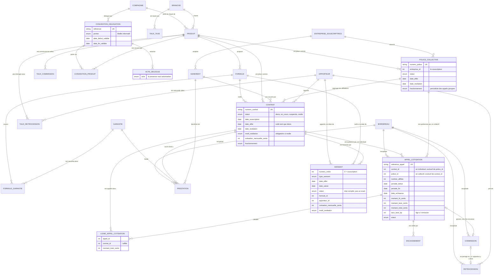

Modèle de données du cœur ERP : diagramme entité-association et justification de chaque choix.

# Modèle de données

Le cabinet modélisé est un **courtier grossiste délégataire** en santé et prévoyance. Trois faits
gouvernent tout le modèle, et il vaut mieux les avoir en tête avant de lire le diagramme :

1. **Le cabinet ne porte pas le risque.** Les compagnies l'assurent. Le cabinet place les contrats,
   encaisse les cotisations, touche une commission de la compagnie et en reverse une part à l'apporteur
   qui a amené l'affaire.
2. **Le cabinet agit par délégation.** Quittancer, encaisser, affilier, radier, régler les prestations
   sont des actes qui appartiennent à l'assureur. Le cabinet ne les accomplit que si une convention le
   lui permet, produit par produit.
3. **Tout acte laisse une trace datée.** L'avenant n'est pas un journal technique posé à côté du
   contrat : c'est lui qui porte l'état du contrat.

## Diagramme entité-association

## Les choix de modélisation, un par un

### L'avenant porte un état complet, pas un écart

Chaque avenant enregistre ce que le contrat **devient** à partir de sa date d'effet : statut, formule,
apporteur, cotisation, fractionnement. Reconstituer l'état au 15 mars 2025 revient donc à lire un seul
avenant, celui dont la date d'effet est la plus récente parmi les dates antérieures ou égales.

La modélisation alternative, un avenant qui ne porte que le champ modifié, oblige à replier tout
l'historique pour connaître un état, et une seule ligne perdue fausse tout ce qui suit. Ici, une ligne
perdue ne fausse que la période qu'elle couvrait. Un gestionnaire qui ouvre un avenant y lit aussi
directement l'état du contrat, ce qui est ce qu'il cherche.

### La santé collective passe par une police, pas par un contrat par salarié

C'est la correction la plus importante apportée après la première vérification. En santé collective,
ce n'est pas le salarié qui souscrit : c'est son entreprise. Elle signe une **police**, et chaque
salarié couvert y est **affilié**.

Le modèle précédent donnait un contrat par salarié et un appel de cotisation par salarié, sans aucune
police ni aucun payeur. La documentation affirmait pourtant que la cotisation était appelée auprès de
l'entreprise : le schéma et le texte ne décrivaient pas le même métier. Un gestionnaire l'aurait vu en
ouvrant le premier dossier collectif.

Ce qui est en place maintenant :

| Objet | Rôle |
| --- | --- |
| `police_collective` | le contrat cadre signé par l'entreprise, avec son produit, son apporteur et ses dates |
| `contrat` avec `police_id` | l'affiliation du salarié, qui garde sa formule, ses garanties et son historique d'avenants |
| `appel_cotisation` avec `police_id` | l'appel **groupé**, adressé à l'entreprise, un par période et par police |
| `ligne_appel_cotisation` | la part de chaque affilié dans cet appel |

**Pourquoi l'affiliation reste un contrat.** C'est le bulletin d'affiliation du salarié : il porte sa
formule, ses garanties, ses prestations et ses avenants, exactement comme un contrat individuel.
Dupliquer toute la mécanique d'historisation pour le collectif n'aurait rien apporté, et le vocabulaire
suit : un gestionnaire parle bien du « contrat » d'un salarié.

**Pourquoi les lignes de détail existent.** Le service comptable de l'entreprise règle un montant
unique, mais le cabinet doit savoir, affilié par affilié, ce qui a été appelé : pour la commission, pour
répartir un règlement partiel, et pour répondre au salarié qui conteste sa retenue sur salaire. Sans le
détail, un appel groupé est une somme que personne ne sait justifier.

**Ce qui n'est pas modélisé**, et qui est dit plutôt que caché : le prorata temporis d'une affiliation
en cours de période, et la répartition entre part patronale et part salariale. Les deux sont dans
`docs/HYPOTHESES.md`.

### Le contrat garde un cache de son état courant

Les colonnes `statut`, `formule_id`, `apporteur_id`, `cotisation_mensuelle_cents` et `fractionnement` de
la table `contrat` dupliquent l'avenant le plus récent. Sans ce cache, afficher la liste du portefeuille
demanderait de reconstituer 5 737 historiques à chaque ouverture d'écran.

Un cache peut dériver. Deux garde-fous : une seule fonction l'écrit
(`domaine.avenants.applique_avenant_au_contrat`), et un test parcourt les contrats en comparant le cache
à la reconstitution, donc par un chemin différent de celui qui l'a produit.

### Un devis ne se résilie pas

Les quatre statuts sont `devis`, `en_cours`, `suspendu`, `resilie`. La transition `devis` vers `resilie`
est **interdite**, et ce n'est pas une subtilité d'implémentation. Un devis qui ne se transforme pas n'a
jamais pris effet : il n'y a pas de garantie à interrompre, pas de préavis, pas de date de fin à
notifier. Il reste au statut devis.

L'enjeu est le taux de résiliation, dont le dénominateur est le portefeuille en vigueur. Compter les
devis sans suite parmi les résiliations ferait apparaître un cabinet qui perd ses clients, alors qu'il
transforme mal ses devis. Deux problèmes différents, deux remèdes différents.

### Un contrat résilié ne revient pas

`resilie` est terminal. Reprendre un ancien adhérent est une nouvelle souscription, avec un nouveau
numéro de contrat et une nouvelle date d'effet. Rouvrir l'ancien contrat effacerait la rupture de
garantie entre les deux périodes, qui est précisément ce qu'une compagnie veut voir.

### Un contrat suspendu reste au portefeuille

La suspension interrompt la garantie, pas le contrat. Le contrat compte donc encore dans le
portefeuille, et la propriété `est_en_portefeuille` retient `en_cours` et `suspendu`. C'est ce que
retiennent les écrans et ce que retiendront les indicateurs du module 3.

### La délégation de gestion est une entité, pas un drapeau

Trois tables : la convention, les produits qu'elle couvre, les actes qu'elle autorise. Un booléen
« délégataire oui ou non » sur la compagnie n'aurait pas suffi, parce que le périmètre réel varie d'un
produit à l'autre et d'une date à l'autre.

Deux décisions à l'intérieur méritent d'être signalées.

**La présence d'une ligne dans `acte_delegue` vaut autorisation, son absence vaut refus.** Pas de colonne
`autorise` booléenne : une ligne à `false` et une ligne absente auraient alors le même sens, et deux
façons de dire la même chose finissent toujours par diverger.

**La portée déclarée n'autorise rien.** Une convention saisie « totale » mais sans ligne pour les
prestations ne permet pas de régler une prestation. Le libellé sert à l'affichage, la liste des actes
seule fait foi, ce qui empêche une convention mal saisie d'élargir un périmètre réel. Un test le
vérifie.

**Aucune autorisation par défaut.** Un produit sans convention en vigueur ne permet aucun acte délégué.
L'inverse, autoriser tant que rien n'interdit, est ce qui produit les incidents : une convention oubliée
lors d'une reprise de données laisserait passer des actes que la compagnie n'a jamais délégués, et
l'anomalie ne se découvrirait qu'au contrôle de la compagnie.

**Où le contrôle s'applique réellement.** Ce document a d'abord laissé entendre que les sept actes
étaient contrôlés alors que seuls trois avaient un chemin d'écriture, puis a continué d'annoncer
`quittancement` et `encaissement` « à brancher au module 2 » alors que le module 2 les contrôlait déjà.
Voici l'état exact, vérifiable dans `src/courtage/flux/controles.py`, fonction `_controle_delegation`,
et dans `src/courtage/flux/rapprochement.py`.

| Acte | Chemin d'écriture | Contrôlé |
| --- | --- | --- |
| `affiliation` | `services.contrats.souscrit_contrat` | oui |
| `avenant` | `services.contrats.ajoute_avenant` | oui |
| `radiation` | `services.contrats.resilie` | oui |
| `gestion_prestations` | `services.prestations.enregistre_prestation` | oui |
| `quittancement` | chaîne du module 2, contrôle de chargement | oui, bloquant : un bordereau de cotisations dont le quittancement n'est plus délégué à la date d'échéance fait rejeter le lot entier |
| `encaissement` | chaîne du module 2, rapprochement | oui, non bloquant : un mouvement rattaché à un contrat dont l'encaissement n'est pas délégué n'est pas rapproché, et il est compté à part |
| `gestion_sinistres` | aucun | aucun acte de prévoyance ne se saisit dans ce projet |

Le générateur applique la même règle, à la même date, par `generateur.delegation_datee`, et un test
confronte les deux implémentations sur les données réelles.

**Un refus visible dans les données de démonstration.** Une convention existe qui est arrivée à échéance
le 30 juin 2026 et n'a pas été renouvelée, sur le produit `PV-ARRET`. Depuis cette date, aucun acte n'y
est délégué : le quittancement s'arrête, et toute saisie est refusée. C'est fréquent dans la vraie vie,
un renouvellement se signe souvent en retard, et c'est ce qui rend le contrôle constatable plutôt que
seulement codé.

### Les montants sont des entiers de centimes, les taux des points de base

Aucun type à virgule flottante dans ce schéma. Un bordereau de commissions qui ne tombe pas juste au
centime est une anomalie comptable, et il suffit d'additionner quelques milliers de flottants pour en
fabriquer une. Les taux suivent la même logique : 10 000 points de base valent 100 pour cent, et
13,27 pour cent s'écrit 1327.

Effet de bord utile : l'entier se comporte à l'identique sur PostgreSQL et sur SQLite, ce que le type
numérique ne fait pas. C'est ce qui permet de faire tourner le même code sur les deux moteurs, et
d'obtenir la même empreinte SHA-256 des données générées.

L'arrondi est implémenté une seule fois, dans `domaine.montants.applique_taux`, au centime le plus proche
avec la demie vers le haut. Deux arrondis différents dans deux coins du code produiraient des bordereaux
qui ne se réconcilient pas.

### La branche et la garantie sont des tables, le statut est une énumération

La règle appliquée partout : **ce que le code doit savoir distinguer est une énumération, ce que le
métier doit pouvoir étendre est une table.**

Le statut d'un contrat est une énumération, parce que le code teste `statut == EN_COURS` pour autoriser
un avenant : une valeur inconnue du code n'aurait aucun sens. La branche d'assurance est une table :
ouvrir une branche automobile ou dommages doit être une insertion, pas une livraison de code.

Les garanties forment un **catalogue global**, et c'est la formule qui dit lesquelles s'appliquent et à
quel niveau, par `formule_garantie`. Rattacher la garantie à une branche aurait obligé à dupliquer
« hospitalisation » autant de fois qu'il y a de branches qui la couvrent, donc à maintenir autant de
référentiels que de branches.

Le projet couvre la santé individuelle, la santé collective et la prévoyance. Il ne couvre pas
l'automobile ni les dommages, et ne le prétend pas : ce qui est démontré, c'est que le modèle produit est
paramétrable par branche, donc extensible.

### Les énumérations sont rendues en VARCHAR, et ce que la base ne vérifie pas

`native_enum=False` plutôt que le type `ENUM` natif de PostgreSQL : la colonne se comporte à l'identique
sur les deux moteurs, et ajouter une valeur ne demande pas de `ALTER TYPE`, opération que l'on ne veut
pas sur la base d'un client.

**Ce document a d'abord affirmé que ces colonnes portaient une contrainte de vérification. C'était
faux**, et la correction mérite d'être expliquée plutôt que effacée. La contrainte a été ajoutée, puis
retirée : avec la convention de nommage du projet, l'autogénération d'Alembic rend la contrainte deux
fois, sous son nom brut et sous son nom conventionné, et PostgreSQL refuse le doublon
(`check constraint already exists`). La migration devenait non portable, ce qui est un prix trop élevé.

Le domaine des valeurs est donc tenu par la **validation applicative** de SQLAlchemy, qui refuse une
valeur inconnue avant l'écriture. Conséquence à assumer : un import en masse ou un correctif SQL manuel
qui contournerait l'application pourrait écrire un statut inconnu, et rien en base ne l'arrêterait.

Les contraintes de vérification **métier** du schéma, elles, sont écrites à la main et listées plus bas.

**Trois d'entre elles n'étaient pas en base, alors que ce document affirmait que le schéma garantissait
l'intégrité.** Le défaut mérite d'être expliqué, parce que sa cause se reproduira chez n'importe qui
utilise Alembic. `ck_appel_cotisation_destinataire_unique`,
`ck_appel_cotisation_au_moins_un_affilie` et `ck_commission_destinataire_unique` ont été ajoutées au
modèle Python par la révision 0003, mais la migration correspondante a été produite par autogénération,
et **`alembic.autogenerate.compare_metadata` ne compare pas les contraintes de vérification**. Elles
n'ont donc jamais été émises. Le test de non-dérive du schéma, `test_le_schema_migre_correspond_au_modele`,
repose sur cette même comparaison : il est resté vert pendant deux révisions.

Conséquence concrète du trou, et c'est pour cela qu'il comptait : un import ou un script de reprise
pouvait écrire un appel de cotisation portant à la fois un contrat individuel et une police collective,
et cet appel aurait été quittancé deux fois.

Correctifs : la révision 0005 crée les trois contraintes, et `scripts/preuve_contraintes.py` tente
cinq écritures interdites en SQL direct sur la connexion, hors de SQLAlchemy, et exige que le moteur les
refuse **en nommant la contrainte**. Il tourne sur les deux moteurs en intégration continue ; ses
résultats sont dans `results/contraintes_sqlite.json` et `results/contraintes_postgresql.json`.

La leçon à retenir pour la suite : une contrainte de vérification ajoutée au modèle doit être écrite à la
main dans la migration, et prouvée par une écriture refusée. L'autogénération ne la verra pas.

### Les taux sont datés, et le calcul va chercher celui du jour de l'acte

`taux_taxe`, `taux_commission` et `taux_retrocession` portent une date de début et une date de fin de
validité. Le calcul retient le taux en vigueur **à la date d'échéance**, pas le taux courant. Un
bordereau de 2024 relu aujourd'hui doit retrouver l'ancien barème.

Le jeu de démonstration pose volontairement un changement de barème de commission au 1er janvier 2025,
pour que ce mécanisme soit exercé par les données et pas seulement affirmé.

Sur la rétrocession, une ligne portant un produit précis l'emporte sur l'accord cadre, qui est la ligne
dont `produit_id` est nul. C'est la pratique du métier : on signe un cadre avec un apporteur, puis on y
déroge produit par produit quand la marge le justifie.

### Le taux de taxe est figé sur l'appel de cotisation

`appel_cotisation.taux_taxe_bp` recopie le taux appliqué à l'émission. Le référentiel suffirait à le
recalculer, mais une relecture de bordereau deux ans plus tard doit retrouver le taux **réellement
appliqué**, même si le paramètre a changé depuis. C'est une exigence de piste d'audit, pas une
dénormalisation de confort.

### Le montant total de l'appel est stocké et vérifié

`montant_total_cents` duplique `montant_ht_cents + montant_taxe_cents`, et une contrainte de vérification
impose l'égalité. Stocker le total permet aux requêtes de pilotage de sommer une colonne ; la contrainte
garantit qu'il ne peut pas mentir.

### L'encaissement peut exister sans appel rattaché, et peut être négatif

`encaissement.appel_id` est nullable, parce qu'un mouvement arrive d'un relevé bancaire **avant** d'être
rapproché. Un mouvement non rapproché est une anomalie à traiter, pas une donnée invalide, et c'est
exactement ce que l'écran des anomalies affiche.

Le montant peut être négatif : un rejet de prélèvement est un encaissement négatif. Le forcer à être
positif obligerait à inventer une table de rejets qui n'existe pas dans un relevé bancaire.

### Une commission par appel, une rétrocession par commission

L'unicité sur `commission.appel_id` et sur `retrocession.commission_id` empêche le double
commissionnement, qui est l'erreur la plus coûteuse de ce calcul et la plus difficile à repérer après
coup. L'apporteur retenu pour la rétrocession est celui en vigueur **à la date d'échéance de l'appel**,
ce qui rend un changement d'apporteur en cours d'année sans effet rétroactif sur les mois déjà réglés.

Ces deux tables sont créées par le module 1 mais **remplies par le module 2** : le calcul des commissions
appartient à la chaîne Airflow et dbt. Les générer aussi ici reviendrait à écrire deux fois la même règle
de calcul, puis à comparer un calcul à lui-même.

### Un bordereau a exactement un destinataire

Un bordereau de commissions vient d'une compagnie, un bordereau de rétrocessions part vers un apporteur.
Jamais les deux, jamais aucun. La contrainte est écrite en SQL portable, avec des expressions `CASE`
plutôt qu'un opérateur booléen, pour se comporter pareil sur les deux moteurs.

### Les index suivent la façon dont un gestionnaire cherche

Les index composés ne sont pas posés au hasard : chacun correspond à une requête d'écran.

| Index | Écran ou calcul servi |
| --- | --- |
| `ix_adherent_nom_prenom` | recherche d'un adhérent au téléphone |
| `ix_contrat_statut_effet` | liste du portefeuille filtrée par statut |
| `ix_contrat_apporteur_statut` | production par apporteur |
| `ix_avenant_contrat_effet` | reconstitution de l'état à une date |
| `ix_appel_cotisation_contrat_echeance` | échéancier d'un contrat |
| `ix_prestation_contrat_soins` | prestations d'un contrat, par date de soins |
| `ix_retrocession_apporteur_periode` | bordereau de rétrocessions mensuel |

Toutes les clés étrangères sont indexées, ce qui évite les parcours complets lors des suppressions et des
jointures.

## Ce que la base refuse

Les règles portées par le schéma, et non seulement par le code applicatif. Un ERP reçoit des écritures
par des imports, des scripts de reprise et des correctifs manuels ; une règle qui ne vit que dans le
service sera contournée un jour.

| Règle | Contrainte |
| --- | --- |
| Un devis n'a pas de date d'effet, un contrat en vigueur en a une | `ck_contrat_date_effet_selon_statut` |
| Résilier exige une date **et** un motif | `ck_contrat_resiliation_datee_et_motivee` |
| La résiliation ne précède pas la date d'effet | `ck_contrat_resiliation_apres_effet` |
| La date d'effet ne précède pas la souscription | `ck_contrat_effet_apres_souscription` |
| Aucune cotisation négative | `ck_contrat_cotisation_positive` |
| Numéro de contrat unique | `uq_contrat_numero_contrat` |
| Deux avenants ne partagent pas un rang | `uq_avenant_contrat_ordre` |
| Un avenant résilié porte un motif | `ck_avenant_motif_si_resilie` |
| Un contrat n'est pas quittancé deux fois pour la même période | `uq_appel_contrat_periode` |
| Une police n'est pas quittancée deux fois pour la même période | `uq_appel_police_periode` |
| Le total d'un appel égale la part hors taxe plus la taxe | `ck_appel_cotisation_total_egale_ht_plus_taxe` |
| Un appel s'adresse à un contrat **ou** à une police, jamais aux deux, jamais à aucun | `ck_appel_cotisation_destinataire_unique` |
| Un appel groupé couvre au moins un affilié | `ck_appel_cotisation_au_moins_un_affilie` |
| Une commission porte le même porteur unique que l'appel qu'elle rémunère | `ck_commission_destinataire_unique` |
| On ne rembourse pas plus que le montant demandé | `ck_prestation_rembourse_inferieur_demande` |
| Une prestation rejetée ne rembourse rien et porte un motif | `ck_prestation_rejet_motive_et_non_rembourse` |
| Une commission ne dépasse pas son assiette | `ck_commission_commission_inferieure_assiette` |
| Une rétrocession ne dépasse pas la commission reçue | `ck_retrocession_retrocession_inferieure_commission` |
| Un bordereau a exactement un destinataire | `ck_bordereau_destinataire_unique` |
| Une seule commission par appel de cotisation | `uq_commission_appel_id` |

Ces contraintes sont vérifiées par `tests/test_integrite.py`, qui écrit sans passer par les services,
pour s'assurer que c'est bien la base qui se défend. Les trois contraintes de porteur unique le sont en
plus par `scripts/preuve_contraintes.py`, qui écrit du SQL brut sur la connexion, donc hors de toute
validation SQLAlchemy, sur les deux moteurs.

Une règle ne peut pas être exprimée par une contrainte : **deux conventions de délégation ne doivent pas
couvrir le même produit à la même date.** Aucune base relationnelle ne sait exprimer « pas deux périodes
de validité qui se chevauchent » de façon portable. Le contrôle est donc fait dans
`domaine.delegation`, et il est bloquant : deviner laquelle des deux conventions s'applique serait pire
que de s'arrêter.

## Portabilité entre PostgreSQL et SQLite

Le schéma est unique et les migrations sont les mêmes. Une seule différence demande du code spécifique,
et elle est importante : **SQLite n'applique pas les clés étrangères par défaut.** Sans la directive
`PRAGMA foreign_keys = ON` posée à chaque connexion, un test passerait en local en insérant un contrat
rattaché à un adhérent inexistant, puis échouerait en production. C'est posé dans `courtage/db.py` et
vérifié par un test.

La preuve de la portabilité n'est pas une affirmation : la même graine produit la **même empreinte
SHA-256** sur les deux moteurs, sur 178 658 lignes. Voir `results/reproductibilite_sqlite.json` et
`results/reproductibilite_postgresql.json`.
